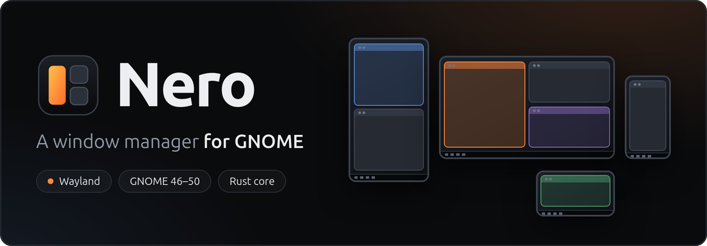
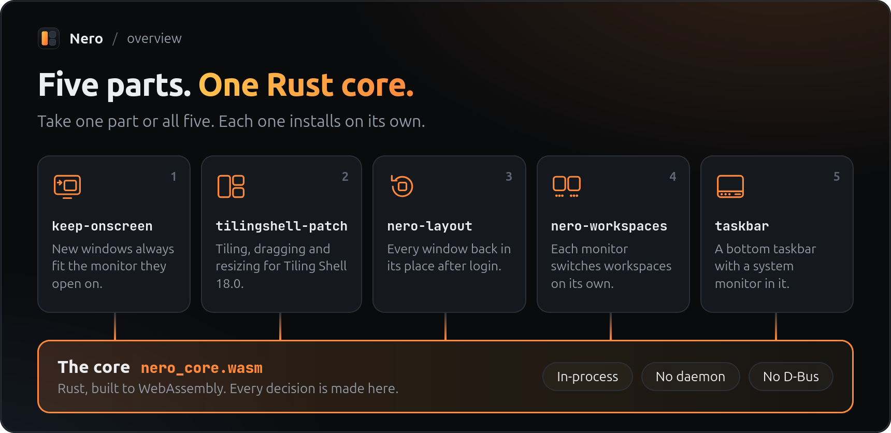
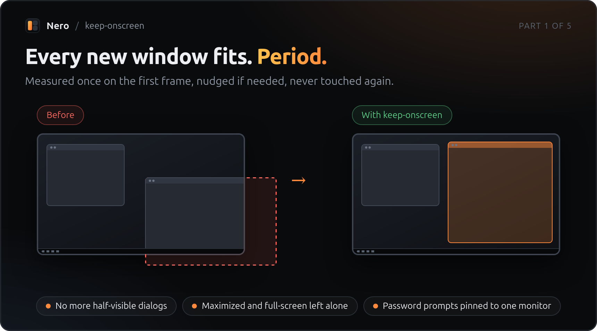
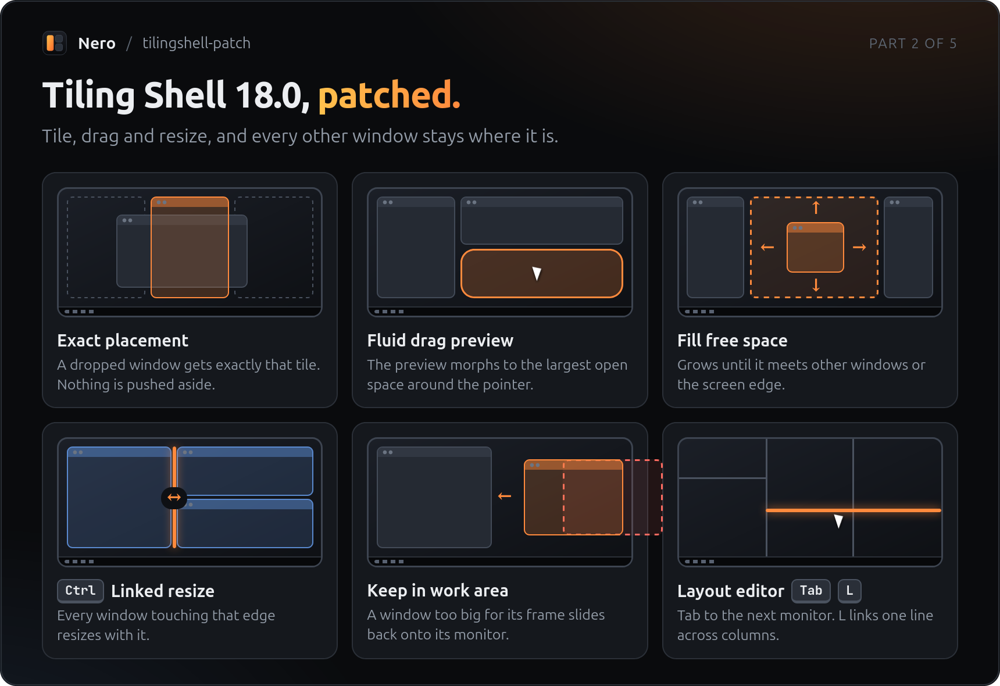
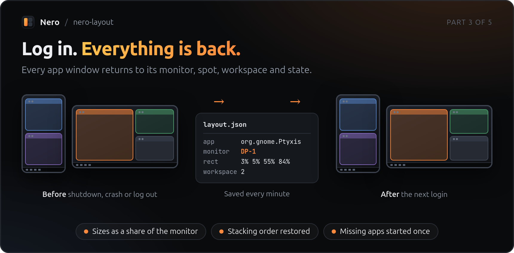
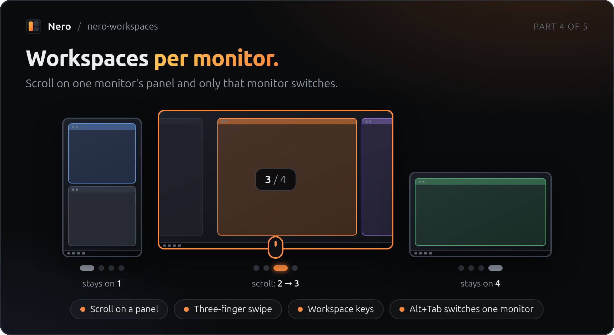
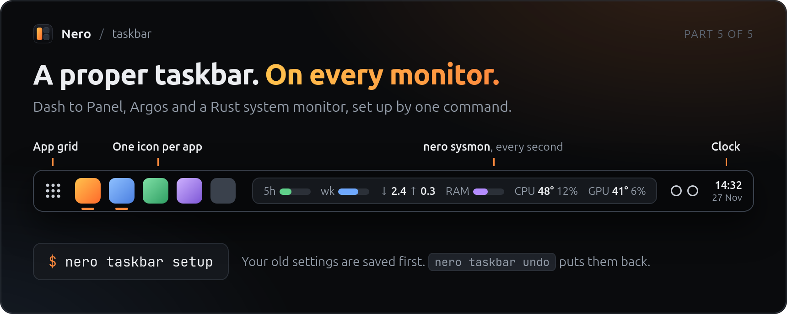
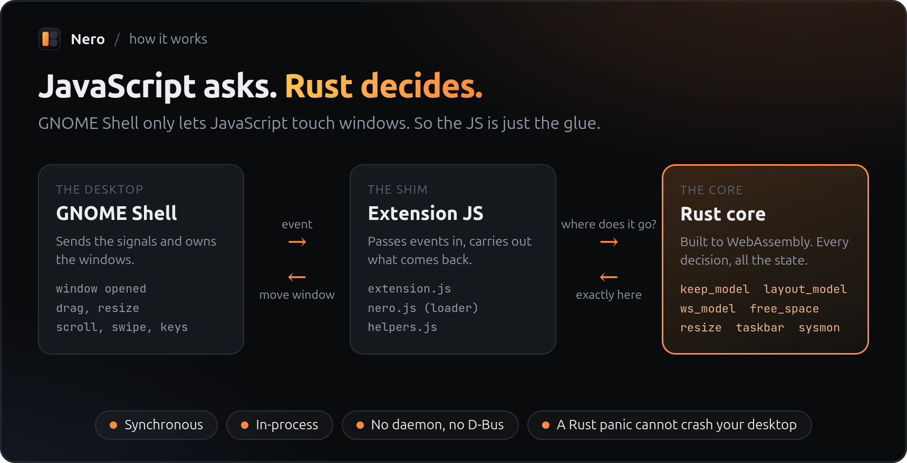

<p align="center">
  
</p>

<h3 align="center">Your GNOME desktop is broken. You just got used to it.</h3>

<p align="center">
  <a href="https://github.com/LudaLunizz/Nero/releases/latest"></a>
  <a href="https://github.com/LudaLunizz/Nero/actions/workflows/test.yml"></a>
  
  
  <a href="#license"></a>
</p>

<p align="center">
  <a href="#whats-new-in-025"><b>What's new</b></a> ·
  <a href="#whats-in-the-box"><b>What's in the box</b></a> ·
  <a href="#the-rust-thing"><b>The Rust thing</b></a> ·
  <a href="#get-started"><b>Get started</b></a> ·
  <a href="#settings"><b>Settings</b></a> ·
  <a href="#license"><b>License</b></a>
</p>

Windows open half off-screen. You tile something and the rest of your layout
explodes. You reboot and spend two minutes dragging everything back where it was.
Your second monitor doesn't get its own workspaces. Your third monitor is basically
a suggestion.

Nero fixes all of that. Five standalone pieces, use whichever ones annoy you the
most — or use them all and wonder why GNOME didn't ship this way.

Wayland. GNOME 46–50. Multi-monitor. Rust core compiled to WebAssembly, running
inside the shell with zero daemons and zero latency. MIT licensed.

---

## What's new in 0.2.5

**The drag preview follows your windows.** Hold the tiling key while you drag,
and the target now takes its columns from the windows already on screen:

- **A full-width window above or below?** The target is full width too, not one
  of your layout's columns.
- **Two half windows on top?** The space below splits right where they do.
- **Nothing placed yet?** Your layout's tiles decide, like before.
- **Portrait screens never get columns.** The target is always full width; only
  the layout's rows divide it.

[Release notes](https://github.com/LudaLunizz/Nero/releases/tag/v0.2.5)

### In 0.2.2

A full code review, every finding fixed. Nothing you rely on changed. Only the
bugs are gone:

- **`nero taskbar undo` really undoes.** Dash to Panel settings, Ubuntu Dock, your
  old Argos script, the split extension: all of it goes back, even if you ran
  setup twice.
- **The drag preview never covers a window**, not even with the pointer exactly on
  a window's edge.
- **A plain drag stays plain.** No tiling key, no snap: the windows next to it are
  left alone.
- **A broken core can't lock you out.** Password prompts always open; every
  extension falls back to plain GNOME and switches off cleanly.
- **One Esc, one step** in the layout editor: the dialog first, then the editor.

[Release notes](https://github.com/LudaLunizz/Nero/releases/tag/v0.2.2)

---

## What's in the box

<p align="center">
  
</p>

### 1. keep-onscreen

<p align="center">
  
</p>

Every new window fits its monitor. Period. No more half-visible dialogs, no more
windows spawning on the wrong edge of a portrait screen. It measures once on the
first frame, nudges if needed, and never touches the window again.

Also lets you pin password prompts to one specific monitor and kill that annoying
dark overlay GNOME puts on every screen while a prompt is open.

### 2. Tiling Shell patch

<p align="center">
  
</p>

A patch set for [Tiling Shell](https://github.com/domferr/tilingshell) 18.0 that
makes tiling behave like you thought it already did:

- **Drop a window, get that tile.** Not a rearrangement. Not a suggestion. That tile.
- **No kidnapping.** Tiling Shell likes to grab your other windows and slide them
  into empty frames. That's off.
- **Fluid drag preview** — a rounded shape that morphs to the largest open space
  around your pointer. Other windows are obstacles, not victims, and they set
  the columns: under a full-width window you get full width. Portrait screens
  only ever split into rows.
- **Fill free space** — Super + right-click and the window grows until it hits
  something. Left, right, up, down. Done.
- **Ctrl-linked resize** — grab an edge while holding Ctrl and every window
  touching that edge moves with it. The whole row breathes together.
- **Layout editor per screen** — Tab switches monitors. Finally. Esc backs out
  one step at a time.

### 3. nero-layout

<p align="center">
  
</p>

Remembers where every window is. Puts them back after login — same monitor, same
spot, same workspace, same stacking order. If an app isn't running yet, it starts
it for you after 15 seconds.

Shut down at 2 AM with 14 windows across 3 monitors? Log back in and they're all
exactly where you left them. That's it. That's the feature.

### 4. nero-workspaces

<p align="center">
  
</p>

Every monitor gets its own workspaces. Scroll on a panel — only that monitor
switches. Keyboard shortcut — only the focused monitor switches. Click a window on
a hidden workspace — only its monitor flips.

Three-finger swipe on a touchpad switches just the monitor under your hand. There's
even a scroll speed setting because GNOME still doesn't have one.

Your monitors are independent. They should act like it.

### 5. taskbar

<p align="center">
  
</p>

A proper taskbar: Dash to Panel at the bottom of every monitor, one icon per app
with window previews, and a built-in system monitor showing CPU, GPU, RAM, network,
and your Claude Code usage — all updating every second from a Rust binary.

The Argos buttons can live on a different monitor than your main panel if you want
your status info out of the way. Changed your mind? `nero taskbar undo` puts back
everything setup touched.

---

## The Rust thing

<p align="center">
  
</p>

The placement logic, the workspace state machine, the layout engine, the tiling
geometry — it's all Rust, compiled to WebAssembly. GNOME Shell only lets JavaScript
touch windows, so the extensions are thin JS wrappers that ask the core where things
go and carry out what comes back.

No daemon. No D-Bus. Synchronous, in-process, and a Rust panic becomes a JS
exception instead of crashing your desktop. If the core is missing or broken, the
extensions fall back to what GNOME and Tiling Shell do on their own: a password
prompt still opens, a drag still drops.

The goal: every decision in Rust, JS only as the GNOME glue.

---

## Get started

**Quickest:** grab a zip from the [latest release](https://github.com/LudaLunizz/Nero/releases/latest)
(check it against `SHA256SUMS.txt`) and install it as a whole:

```sh
gnome-extensions install --force nero-layout@LudaLunizz.v0.2.5.shell-extension.zip
# log out, log back in, then:
gnome-extensions enable nero-layout@LudaLunizz
```

The Tiling Shell patch and the `nero` command are not zipped: build those from
source as below.

**From source:** you need Rust (edition 2024) with the WebAssembly target:

```sh
rustup target add wasm32-unknown-unknown
```

Then pick your parts:

<details>
<summary><b>keep-onscreen</b></summary>

```sh
./core/build.sh
cp -r keep-onscreen/nero-keep-onscreen@LudaLunizz ~/.local/share/gnome-shell/extensions/
glib-compile-schemas ~/.local/share/gnome-shell/extensions/nero-keep-onscreen@LudaLunizz/schemas
# log out, log back in, then:
gnome-extensions enable nero-keep-onscreen@LudaLunizz
```

</details>

<details>
<summary><b>Tiling Shell patch</b></summary>

```sh
./tilingshell-patch/apply.sh              # downloads Tiling Shell 18.0, patches it
./tests/run.sh                            # logic tests (needs gjs)
./tilingshell-patch/apply.sh --install    # replaces your installed Tiling Shell
# log out and back in
```

An update from extensions.gnome.org overwrites the patch — run `apply.sh --install`
again.

</details>

<details>
<summary><b>nero-layout</b></summary>

```sh
./core/build.sh
cp -r nero-layout/nero-layout@LudaLunizz ~/.local/share/gnome-shell/extensions/
glib-compile-schemas ~/.local/share/gnome-shell/extensions/nero-layout@LudaLunizz/schemas
# log out, log back in, then:
gnome-extensions enable nero-layout@LudaLunizz
```

Layout saves to `~/.local/state/nero/layout.json` every minute. Set `restore-now`
to `true` to restore without logging out.

</details>

<details>
<summary><b>nero-workspaces</b></summary>

```sh
./core/build.sh
cp -r nero-workspaces/nero-workspaces@LudaLunizz ~/.local/share/gnome-shell/extensions/
glib-compile-schemas ~/.local/share/gnome-shell/extensions/nero-workspaces@LudaLunizz/schemas
# log out, log back in, then:
gnome-extensions enable nero-workspaces@LudaLunizz
```

</details>

<details>
<summary><b>taskbar</b></summary>

Install [Dash to Panel](https://extensions.gnome.org/extension/1160/dash-to-panel/)
and [Argos](https://extensions.gnome.org/extension/1176/argos/) from
extensions.gnome.org first, then:

```sh
cargo install --path cli --locked
nero taskbar setup                        # taskbar at the bottom + system monitor
nero taskbar setup --monitor DP-1         # same, Argos buttons on DP-1
nero taskbar undo                         # put back what setup changed (settings, dock, script)
```

</details>

---

## Testing without logging out

Try changes in a nested shell so you don't have to relog every time:

```sh
dbus-run-session -- gnome-shell --nested --wayland
```

Use a separate dconf profile so your real settings stay clean.

---

## Settings

Every extension has gsettings keys for fine-tuning. The detailed reference for each
one — password prompt placement, layout timing, workspace count, scroll cooldown,
touchpad speed, skip lists — is in the source under each extension's schemas.

---

## License

MIT for everything — the Rust core, keep-onscreen, nero-layout, nero-workspaces,
the CLI and the taskbar setup.

The one exception: `tilingshell-patch/` is a derivative of
[Tiling Shell](https://github.com/domferr/tilingshell) by Domenico Ferraro and
stays GPL-3.0, like Tiling Shell itself.
